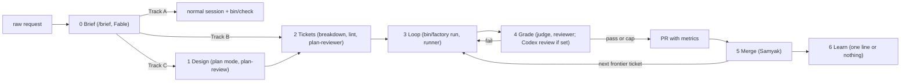

# Loam Factory: architecture

The factory takes a raw request to a merged pull request through unattended loops and independent Opus 5.5 graders, on Loam and, after F8, on projects Loam seeds.
This file is the one home of the stage table, the single sources of truth, the standing do-not-touch list, the model rules, and the placement table.
The brief and ticket formats live in `CONTRACT.md`, the supervisor in `LOOP.md`, the build order in `ROADMAP.md` (superseded; the campaign index that replaced it, `../archive/architecture-working/tickets/README.md`, is parked by ruling R6 of 2026-10-25), the evidence in `../research/INDEX.md`.
Everything here describes the target; a thing that exists at the time of writing (2026-09-07) says so.

## Design rules

- Deterministic steps run in code; judgment steps run in a model; one human checkpoint at PR merge.
- A known command is code, not an agent: anything a ticket can name as a command runs in the supervisor.
- The agent that does the work never grades the work; graders run fresh, read-only, on frozen prompts, in a context separate from the worker's; Models and roles names their model.
- What Samyak does not want is written down as firmly as what he wants: Out of scope in every brief and ticket, Do not touch per ticket, ADRs from the design session, and the lean-critic on every diff.
- One ticket, one worktree, one branch, one run directory; parallel runs gated by `MAX_PARALLEL` (`LOOP.md`).
- One directive has one home; a duplicate is a bug.
- Every harness component is a dated bet on a model weakness and must justify its keep after each upgrade: remove one at a time and replay the graders.
- When Samyak does not know the solution, the factory proposes before it asks: options with evidence first, then Samyak picks.

## Stages

| Stage | Input | Actor, model, effort | Samyak does | Output | Gate to next |
|---|---|---|---|---|---|
| 0 Brief | raw request | Fable 5.1 high, interactive, `/brief` (F5) | corrects the echoed brief, accepts | Track A: nothing. Track B: one ticket. Track C: a design issue whose top section is the brief | A exits; B to stage 2; C to stage 1 |
| 1 Design (Track C) | design issue | when the brief is `Mode: figure-out`, `surprise-me` in panel mode and a research pass against primary sources first; then Fable plan mode with Opus Explore subagents; `/plan-review` blind on Fable, whose elegance gate writes two competing designs before a verdict; the design session writes ADRs for the decisions Samyak makes; lean-critic on the design issue | reacts to the options, answers the design session's questions, approves | design issue body (brief, destination, deliverables, constraints, proof, no implementation detail), ADRs in `docs/adr/` | review verdict recorded, ADRs committed |
| 2 Tickets | design issue, or the one Track B ticket | Fable breaks the design into tickets and publishes them (`CONTRACT.md`, Publishing a breakdown); issue bodies use the ticket contract; `bin/factory lint` (F2); `plan-reviewer` by hand and lean-critic once over the breakdown | approves the breakdown | GitHub issues, native blocking edges, label `ready-for-agent` | lint exit 0, `plan-reviewer` pass |
| 3 Loop | one ticket | `bin/factory run <issue>` on the runner (F1): round 0, then worker rounds on `claude-opus-5-5` at the ticket's effort (default high) or `codex exec` | nothing; may run `bin/factory stop`, or edit the issue body and relaunch | branch, commits, a run directory | checks exit 0, clean tree, do-not-touch clean |
| 4 Grade | diff and evidence | Opus 5.5 high judge and reviewer, read-only, fresh, frozen per run; Codex review stage when the ticket sets it | nothing | JSON verdicts, PR with metrics and merge checklist | judge pass and no blocking finding, or the grader-round cap with a backlog, or a judge pass with a review finding past its one block or from a reviewer or Codex review with no parseable reply (a draft PR), or a judge with no parseable reply after three calls (a draft PR) |
| 5 Merge | PR | Samyak with `bin/runner bin/factory status`; `claude ultrareview --json` optional on high risk | ticks the merge checklist, merges | merged main; the PR's `Closes #N` closes the ticket | human merge, never the loop |
| 6 Learn | `bin/factory status` | the manager session (rule in `LOOP.md`) | nothing | a `CLAUDE.md` line, a lint rule, or nothing | none |

## Single sources of truth

- The GitHub issue body is the only ticket text; an addendum is an edit to the body, never a comment; the loop reads the body only.
- The design issue body is the only home of the brief and the design once accepted.
- Each rubric lives in its grader file only; no doc restates a rubric (a build ticket may name target row names).
- Loop state lives in the run directory (`LOOP.md`); the PR body carries the per-ticket metrics; the manager session holds no state.
- The stage table lives here only; its "Samyak does" column is the runbook.
- Research lives in `../research/` with one index.

## Working-file whitelist

`.superpowers/<slug>/` may hold `BRIEF.md` and `DESIGN.md` as drafts until accepted, and nothing else.
No `PLAN.md`, `NOTES.md`, `BACKLOG.md`, or scope file is created per effort.

## Standing do-not-touch list

Every ticket's Do not touch section starts from this list and may add paths.
This list is Loam's; another target's lives under the same heading in its own `docs/factory/STANDING.md` (`LOOP.md`, Run the factory on another repository).
It may exempt a listed path only with an `Except:` line naming a path its Goal creates or rewrites; nothing else leaves the list.
The supervisor execs its frozen copy of `bin/factory`, so a ticket that edits the factory takes effect on the next run.

- `.claude/settings.json`, `seed/.claude/settings.json`, and every deny list
- `seed/.claude/hooks/`, `seed/.codex/`
- `seed/bin/`
- `VERSION`, `bin/release.sh`, `.github/workflows/`
- `bin/factory`, `bin/factory.d/`, and any grader file
- `.codex` - a Codex round swaps this symlink for a real directory and restores it; a commit that changes it is a hit

Scope beyond the ticket goal outside this list is a judge finding, not a stall.

## Models and roles

- The loop's model and effort defaults live in `bin/factory`; `bin/factory graders-check`, a `bin/check` step, fails when `judge.md` or `reviewer.md` front matter disagrees with `GRADER_MODEL` or `GRADER_EFFORT`.
- Every loop role is `claude-opus-5-5` (Samyak, 2026-09-24): worker, its subagents, advisor, judge, reviewer, and eval replay.
- Judge and reviewer are fresh Opus 5.5 at high in the loop (Samyak 2026-09-24, overriding the #186 eval; F38 measures what they miss); the lean-critic, picked by #186, is Opus 5.5 at high, by hand on the PR.
- The plan-reviewer is Fable 5.1 at high, by hand outside the loop (F0 sets its frontmatter).
- The loop worker, with Explore subagents on the same model, runs at the effort its ticket sets: high by default, xhigh when the ticket needs deeper reasoning (Samyak 2026-09-24); a `size: large` ticket's builders and integrator run at xhigh (`factory-round.js`). Replaced claude-opus-4-8[1m] on 2026-09-22.
- The loop worker carries an advisor (`--advisor claude-opus-5-5`, F11 2026-09-10): the worker decides when to consult it; `FACTORY_WORKER_ADVISOR=` (explicit empty) turns it off; each worker ledger line records `advisor_calls` and `advisor_usd` (from the session transcript: a token-weighted estimate while the advisor shares the worker's model, null when the transcript is missing). Kept while the ledger shows lower usd per ticket or fewer and less severe grader findings.
- Brief and design sessions are Fable 5.1 at high, interactive.
- Never Sonnet or Haiku; any flag that defaults to Haiku is overridden or unused; every `Agent` call names its model.
- The one named exception: Codex may be the worker (`worker: codex`) or an added reviewer (`codex-review: yes`); the judge and reviewer always run.

## Where things live

| Thing | Home | Reaches a seeded project |
|---|---|---|
| Graders | `cultivation/marketplace/sam-cc-setup/agents/`: `judge.md`, `reviewer.md`, `lean-critic.md` | through the plugin, or `bin/loam-attach.sh` |
| `/brief` skill | `cultivation/marketplace/sam-cc-setup/skills/brief/` (F5) | through the plugin |
| `bin/factory`, `bin/factory.d/` | Loam `bin/` (F2, F6, F1) | any repo via `-C` (F8 step 1); the code stays in Loam (`LOOP.md`, Run the factory on another repository) |
| `evals/` | Loam root (F6) | no |
| Design docs | `docs/factory/` | no |
| Research | `docs/research/` | no |
| Runs | the runner, outside every checkout (`LOOP.md`) | n/a |

Placement follows `../ASSET-LAYERS.md`.
Preconditions live in `LOOP.md`; `bin/factory status` checks them.

## Metrics

The PR body is the metrics home: rounds, spend, wall time, first failing grader, permission denials per round, and the merge checklist.
Expected saving over lean-v3 is the stall rounds; the per-round grader cost is unchanged.
Criteria written in advance, measured over every run of the target; a file-ticket rehearsal opens no PR, so it is not a PR run:

- operator actions from voice note to a running loop on Track B: at most 3 (measured as a lower bound: the run sees only the issue's events and the lint, run and stop subcommands)
- operator actions after the PR opens: at most 1 once F9 lands (measured as a lower bound: the run sees only the PR's events)
- stalls whose first failing grader row is scope: 0 (baseline 3 of 4)
- rounds lost to environment failures: 0 (baseline 2)
- lines per round marking a passed-over step: 0
- median rounds to PR: at most 5 (lean-v3 median)
- judge fails citing a worker-written measurement: 0 (S2 had at least four)
- rounds whose last worker message claims done while the checks printed FAIL: 0

Measure with `bin/factory status --criteria` on the runner, where the run directories live.
Each run directory feeds it: `factory.log` EXIT lines for stalls (`stuck`, `no-change`, `stopped-cap`; a scope stall when that round's first `FAIL` line is `do-not-touch`), `owner-events.jsonl` for the operator actions (`phase` `launch` from the issue's events and each owner-run `lint`, `run` and `stop`, `phase` `pr` once `next` sees the PR closed), the `SKIPPED:` lines `guard` copies into `round-<k>.checks`, `evidence_kind` in `round-<k>.judge.json`, and each failing round's last worker message (`round-<k>.last.txt` for Codex, `.result` of `round-<k>.result.json` for Claude).
